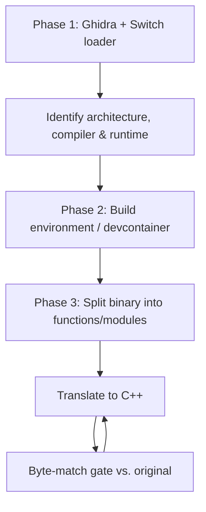

# Soaratorium

A work-in-progress **decompilation of _Monster Hunter Generations Ultimate_** for the
Nintendo Switch.

The objective is a **clean-room reconstruction** of the game's shipped executable as a
buildable C++ source tree: functions reverse-engineered from its assembly, reproducing the binary **byte-for-byte** (or as close
as the toolchain allows), validated function by function with a diff tool.

> **This does not produce a game executable.** It cannot, and will not, run the game.

> **Status: early planning.** The analysis environment (Ghidra + Switch loader) is set
> up; the target is **AArch32 (32-bit ARM)**, and translated code will be **C++17**. The target title version is settled: the
> **latest update patch**. The toolchain is settled to a **de facto pin**
> — **clang 5.0.1** (VFP-only) plus two backend flags — which reproduces all seven probe
> functions byte-for-byte; no *stock* clang configuration does, and the real NintendoSDK
> toolchain is not obtainable, so this stand-in is used. Bulk translation has not started.
> This document is a living outline and will be revised as the project progresses — see
> [AGENTS.md](AGENTS.md) for LLM code assistance conventions.

---

## Table of Contents

1. [Approach](#approach)
2. [Phase 1 — Analysis tooling (Ghidra + Switch support)](#phase-1--analysis-tooling-ghidra--switch-support)
3. [Phase 2 — Build environment](#phase-2--build-environment)
4. [Phase 3 — Decompilation workflow](#phase-3--decompilation-workflow)
5. [Development environment (devcontainer)](#development-environment-devcontainer)
6. [Repository layout](#repository-layout)
7. [References & inspiration](#references--inspiration)

---

## Approach

The effort proceeds in three phases; each produces tooling and findings the next
depends on.



**Guiding principle:** the original binary is the single source of truth.
Initial effort is to focus on byte match, with readability being secondary __to some degree__ (this is a learning project too, there's no point to this if developers can't understand and learn from the code).
Readability will be a bigger focus once most (90% or more, lets say) of the code has a byte match.

---

## Phase 1 — Analysis tooling (Ghidra + Switch support)

Set up Ghidra with Switch binary support so the game's executable can be loaded,
navigated, and decompiled — this is how the architecture, compiler, and runtime are
identified.

- **Ghidra** — disassembler/decompiler (installed in the devcontainer).
- **Ghidra Switch Loader** ([adubbz/ghidra-switch-loader](https://github.com/adubbz/ghidra-switch-loader)) —
  loads the Switch executable format and auto-detects 32- vs 64-bit ARM.
- **GhidraMCP** ([LaurieWired/GhidraMCP](https://github.com/LaurieWired/GhidraMCP)) —
  optional MCP bridge exposing Ghidra to coding agents (evaluation pending;
  headless scripting may suffice).

**Outcomes:**

1. Load the game's `main` executable into a Ghidra project.
2. Confirm the target **architecture** (32- vs 64-bit ARM) — ✅ **AArch32**.
3. Identify the **compiler, language standard, and runtime** (SDK version, libc).
   This is critical: byte-matching depends on the toolchain, so it gates all of
   Phase 2. — ✅ **language = C++17**, runtime = NintendoSDK 4.4.x `nn::` + libc++,
   compiler = **clang 5.0.1** (de facto pin, VFP-only + two hidden backend flags). No
   stock clang configuration reproduces the build exactly; the pin is a reproduction
   stand-in that byte-matches all seven probe functions. See [AGENTS.md](AGENTS.md) and
   [`docs/compiler-identification.md`](docs/compiler-identification.md).
4. Record findings in [AGENTS.md](AGENTS.md) and/or `docs/`.

> **Confirmed:** the executable is **32-bit ARM (AArch32)**, not the more common 64-bit
> (AArch64) Switch target. Two independent sources agree: the NPDM metadata
> (`Is64BitInstruction: false`, `ProcessAddressSpace: AddressSpace32BitNoReserved`) and
> the Ghidra Switch Loader, which selects `ARM:LE:32:v8` (image base `0x60000000`) when
> importing the executable. This matches the community project
> [`Fexty12573/forge`](https://github.com/Fexty12573/forge) — an MHGU-linking,
> hooking and patching environment — which builds against **devkitPro/devkitARM** and
> uses a `switch32.ld` linker script. See [AGENTS.md](AGENTS.md) for the loader-built
> memory map and the tooling implications.

---

## Phase 2 — Build environment

Assemble a reproducible environment that compiles translated C++ with the **exact**
toolchain that reproduces byte-identical output.

- **Devcontainer / Dockerfile** as the source of truth for the toolchain (the
  analysis environment already lives here — see below).
- **Pin** the compiler/SDK version identified in Phase 1; no unsanctioned upgrades.
- Provide build scripts (make/cmake/ninja) that link translated objects against the
  original binary's layout (addresses, sections, data/BSS placement).

**Outcomes:**

- A container/devcontainer that yields a working, pinned toolchain.
- A first "hello world" object built from translated C++ that matches its counterpart
  in the original binary.

---

## Phase 3 — Decompilation workflow

Turn the monolithic binary into an incremental, per-function translation pipeline.

- **Function splitting** — scripts to isolate the binary's functions into individual
  compilation units so each can be matched in isolation.
- **Module isolation** — group related functions into logical source modules
  mirroring the original layout, with a consistent naming scheme.
- **Translation** — convert assembly to C++, one function at a time. Two workflows
  are first-class:
  - **Manual** — decompile with Ghidra, hand-write C++, verify each attempt.
  - **Automated** — template matching for common function shapes and/or LLM-assisted
    translation. Both workflows pass the *same* verification gate.
- **Byte-match gate** — verify each compiled function against the original with a
  diff tool (reccmp / asm-differ / a decomp.me-style differ). Byte-matching is the
  standard, but some functions may only reach a *behaviour* match.
- **Relocation check** — beyond the byte diff, verify that callee/global references
  relocate correctly, not just the unlinked instruction bytes.
- **Near-miss bank** — record attempts that compile to *almost* the right bytes (how
  far off, what was tried) so dead ends aren't rediscovered.

**Outcomes:**

- A repeatable command that, given a function, reports "match" or "mismatch".
- A progress tracker of matched vs. unmatched functions.

---

## Development environment (devcontainer)

The analysis environment is reproducible via the devcontainer in `.devcontainer/`
(also usable as a plain Docker image).

**What it provides:**

- **Ghidra 12.1.2** (pinned) at `/opt/ghidra`, plus a bundled **Java 21 JDK**.
- The **Ghidra Switch Loader** extension, pre-installed under `Ghidra/Extensions`.
- Convenience wrappers in `.devcontainer/scripts/`:
  - `ghidra-headless.sh` — headless Analyzer (agents/automation).
  - `ghidra-gui.sh [vnc|x11]` — Ghidra's GUI, reachable via noVNC in a browser or a
    native X server.

>🤖
> - **clang 5.0.1** (the Phase 1 de facto pin) at `/opt/clang-5.0.1`, on `PATH` — the
>   cross-compiler for Phase 2 — together with the `libtinfo5` it needs.
>
> Only the *bare* compiler is installed; the project's target flags are applied by the
> build (see [AGENTS.md](AGENTS.md) for the authoritative list). The compiler is a
> **stand-in**: no stock clang configuration reproduces the original build exactly, so a
> small fraction of functions may only reach a *behaviour* match.
>🤖<

**Getting the game's executable:** you'll need the original `main` executable from
your own copy of the game. To dump it from a Nintendo Switch, follow the instructions
on the [smo.wiki guide](https://smo.wiki/Guide:Dumping_and_extracting_your_ROM).
Place it under `baserom/`

**Build the image:**

```sh
docker build -f .devcontainer/Dockerfile -t soaratorium-devcontainer .
```

**Run a shell with the repo mounted:**

```sh
docker run --rm -it -v "$PWD:/workspace" -w /workspace soaratorium-devcontainer
```

Or open the folder in a devcontainer-aware editor (VS Code / Zed) and "Reopen in
Container". The container forwards port `6080` for noVNC, and `.devcontainer.json`
declares `clangd` for C/C++ tooling.

> **Note:** Ghidra's GUI is usually unnecessary — headless analysis is the intended
> path, and any GUI/TUI front-end can be layered on later.

---

## Repository layout

>🤖
> ```text
> Soaratorium/
> ├── README.md              # This document (for contributors)
> ├── AGENTS.md              # Conventions & findings for coding agents
> ├── LICENSE.md             # GPL-3.0
> ├── baserom/               # Your local copy of the game (git-ignored)
> ├── .devcontainer/         # Phase 1 analysis environment (Ghidra + loader)
> │   ├── Dockerfile
> │   ├── devcontainer.json
> │   └── scripts/
> ├── docs/                  # Analysis findings (architecture, compiler, SDK)
> ├── poc/                   # End-to-end 7/7 byte-match showcase harness
> │   ├── run.sh             #   entry point: import → dump → compile → match
> │   ├── probes.tsv         #   probe table (source / address / size)
> │   ├── src/               #   reconstructed C++ for the seven probes
> │   └── lib/               #   helpers: slice .text, byte-compare, diff
> ├── tools/                 # Decompilation helper scripts
> │   ├── ghidra/            #   GhidraScripts (import, dump, inventory export)
> │   ├── ledger/            #   the ledger: generator, validator, byte gate, shared lib
> │   └── nso/               #   NSO extraction / section compare / text align
> ├── config/                # Toolchain pin + the committed symbol ledger
> │   ├── toolchain.json     #   the pinned clang flags
> │   └── main/
> │       └── ledger.tsv     #   the (module, addr) ledger — the denominator & build seed
> └── src/                   # Translated C++ source                        [planned]
> ```
>
> Layout beyond `.devcontainer/` is still being finalized as each phase lands.
>🤖<

---

## References & inspiration

Prior art for tooling, workflow, and repository conventions (see also
[AGENTS.md](AGENTS.md) for the agent-relevant subset):

- **MonsterDruide1/OdysseyDecomp** — the closest analog: a modern Switch
  byte-matching decomp. Source of our devcontainer-style setup, per-function
  metadata.
- **tangosdev/sm64ds-decomp** — LLM-automation-first matching decomp. Borrow the
  automatic templates, near-miss database, relocation-aware reference checking, and
  claims/coordination protocol — but we support **both** manual and automated
  workflows (again, it is a learning project after all).
- **Xeeynamo/sotn-decomp** — clean `tools/` layout and a `Dockerfile`; uses `splat`,
  `asm-differ`, `decomp-permuter`, `decomp.me`, `frogress`.
- **pret** — `pokeemerald`, `pokefirered`, etc.: canonical matching-C decomp with
  clear module layout, naming, and build system.
- **zeldaret** — `oot`, `mm`: mature matching-decomp structure and tooling.
- **open-ead/nx-decomp-tools** — Switch-specific decomp tooling (function
  metadata/lists, relocation-aware reference checking, progress tooling). Note:
  its current implementation targets AArch64 only — see [AGENTS.md](AGENTS.md).
- **Fexty12573/forge** — MHGU linking/hooking/patching environment; useful for build
  mechanics and internal data-structure hints (see the AArch32 lead above).
- **Nintendocustom/Lego-City-Undercover-Decompilation** — third-party Switch C++
  matching decomp; the closest toolchain analog (clang 3.9.1 + CMake/Ninja + musl
  sysroot + the OdysseyDecomp-family `tools/`).
- **open-ead/sead** — first-party Nintendo C++ standard-library decomp; evidence that
  upstream Clang byte-matches Switch code (`MATCHING_HACK_NX_CLANG`).
- **sbergeron42/ssbu-decomp** — Smash Ultimate; documents which code resists stock
  Clang (some SDK internals).
- **reccmp** / **asm-differ** — the byte-matching diff tools themselves.
>🤖
> - **splat** — disassembler + data extraction driven by a symbol map; a *study reference only*
>   (its AArch32 support is unconfirmed). Our segmentation seed is a Ghidra inventory export,
>   not a third-party splitter — see [docs/architecture.md](docs/architecture.md).
>🤖<
- **decomp-permuter** — permutes candidate source variants to find the spelling that
  byte-matches.

*(This section will grow as the project discovers what's actually applicable.)*
