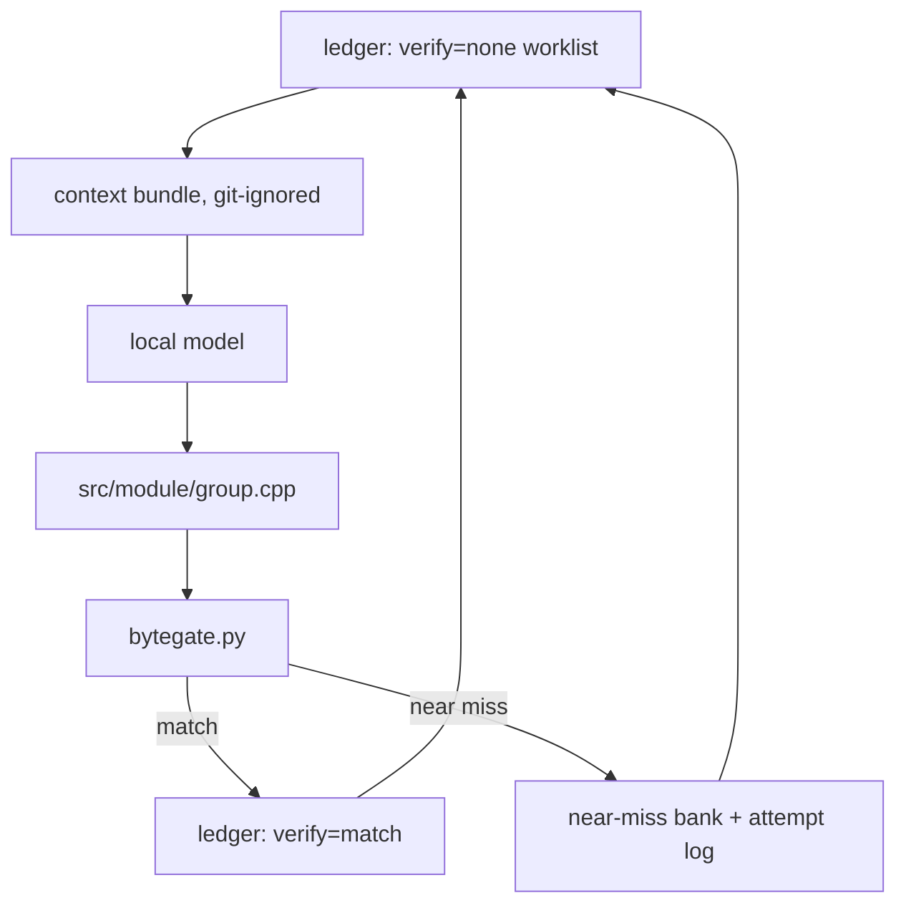

# LLM harness design (Phase 3 — the reconstruction loop)

The design for the tooling that **produces** reconstructed C++ from the original binary,
compiles it with the pinned toolchain, and banks the results. It is the counterpart to the
**byte gate**, which *verifies*. This document is design-first: the decisions below are agreed,
the code does not exist yet.

See also [`architecture.md`](architecture.md) → *Unmatched-function fallback* (why Model C),
*File layout & generated build* (where files come from), and [`tooling-survey.md`](tooling-survey.md)
→ the sm64ds pipeline (the mechanism this is modelled on).

---

## Where this sits

Two halves, and the split is load-bearing:

- **The gate — built.** `tools/ledger/bytegate.py` compiles one function and byte-diffs the
  function **body** against the original (the ledger's `size` is a block *partition*, an upper
  bound — see the gate's own docstring). It is the **only** writer of the ledger's `verify`
  axis, and it is independent of anything that produces a candidate.
- **The harness — this document.** Everything that *produces* candidates: it selects work,
  builds the model's context, calls the model, writes source, and invokes the gate. It never
  claims a match itself.

The rule, borrowed verbatim from sm64ds `tools/bank.py`: **never trust the solver's own claim
of a match — verify independently.** The harness proposes; the gate disposes.



---

## Worklist — the ledger is the queue

There is no separate worklist file: the **committed ledger** is the worklist, filtered to
entries with `verify=none` (later: `behaviour` entries eligible for a byte-match retry).
Deterministic ordering (by `(module, addr)`), `data` and `external` kinds skipped for the
reconstruction loop. Because selection is derived from the ledger, the queue updates itself as
`verify` changes — no second artifact to drift.

---

## The declaration layer (Model C stubs)

Model C means an unmatched callee must at least be **declared** so the tree compiles. The
ledger supplies *identity* and, for externals, the exact Itanium-mangled name — and mangling
**encodes the parameter types**, so signatures are recoverable almost for free (`c++filt` /
`llvm-cxxfilt` are both installed; there are **761** external rows, e.g.
`_ZN2nn2fs11GetFileSizeEPxNS0_10FileHandleE` → `nn::fs::GetFileSize(long long*, nn::fs::FileHandle)`).

**Decided — phased, `asm` first, committed `include/` tree later.**

- **Phase A (now): pin the symbol, approximate the type.** Declare a call with an
  ABI-compatible prototype but force the exact mangled symbol with `asm`:

  ```cpp
  namespace nn::fs {
  int CreateFile(char const*, unsigned long long) asm("_ZN2nn2fs10CreateFileEPKcx");
  }
  ```

  This decouples **link identity** from **type completeness**: relocations resolve to the
  exact original symbol even while the C++ type set is still being reconstructed. It does *not*
  remove the ABI obligation — a by-value aggregate parameter (`nn::fs::FileHandle`,
  `nn::account::Uid`) still needs a correct layout to compile at all.
- **Phase B (grow): a committed `include/` tree reconstructed incrementally.** Types are
  added only as functions need them, and `asm` labels are retired as real declarations land.
  There is no wholesale generator, because **the hard part is type *definitions*, not
  signatures**: the ledger deliberately does not carry structs/classes (the nested-symbol table
  is *reference material*, never the ledger), so the type set is hand-grown — the
  `lib/nnheaders` problem in reverse.

  Seed the review with a **demangle pass** over the ledger's externals that emits *candidate*
  prototypes; signatures are exact, types are not.
- **Internal placeholders (`func_<addr>`)** have no mangling (C ABI). Declare them loosely
  (signature inferred from call sites or guessed); for byte-matching this is usually harmless
  — the first args go in `r0–r3`, the return in `r0` — and only matters for struct-by-value /
  64-bit / FP edge cases.

**Decided — link-time resolution of unmatched *internal* symbols.** "Declared but not
  defined" keeps the tree *compiling*; a developer executable still has to *link*. The options
  are staged, exactly like Model C → Model B in [`architecture.md`](architecture.md) →
  *Unmatched-function fallback*:

  - **The scaffold links nothing (compile-only).** The gate compiles one TU to an object and
    diffs the function's section; no linker is invoked. This is already how `bytegate.py`
    works, needs no stubs, and carries no ABI risk. The generated build stays *link-optional*:
    it can grow a linker script (with `-ffunction-sections -fdata-sections`, placement is
    per-section) without rework.
  - **Model C (a runnable developer executable) = weak stubs.** The generator emits each
    unmatched internal symbol as an empty, ABI-safe `__attribute__((weak))` definition; a
    matched function is a strong definition the linker prefers. Empty stubs are ABI-safe (the
    callee ignores `r0–r3`; the *caller's* bytes — all the match sees — are unaffected), and
    weakness removes the churn a strong-stub set would cause as functions flip to matched.
  - **Model B (the relocation/link check) = byte substitution.** Unmatched *regions* are
    filled from the original binary by the build (`rombytes`/`delinks`), so the linked image is
    byte-correct everywhere and the relocation check is meaningful. This is the one option
    that carries real AArch32 work — the NSO is a PIE with `.rel.dyn`/`.rel.plt` — and it is a
    scoped task of its own, not a scaffold rider.

  **Externals are a separate axis.** The `nn::` imports resolve via the loader/dynsym; a
  static link needs import stubs or the NSO import table. That is *external* resolution and
  does not bear on this decision.

---

## The context bundle

The bundle is the model's entire view of a function. It is **disassembly-first and annotated**,
and it is **generated into the git-ignored `baserom/work/` tree and never committed** (binary
content stays out of git — [`AGENTS.md`](../AGENTS.md) → *Repository hygiene*).

Per `(module, addr)` the bundle carries:

- **Annotated disassembly of the original.** Raw linear disasm is not enough: resolve each
  `bl`/`blx` to its callee, each pc-relative load to its literal-pool value/symbol, and mark
  branch targets. (Extend `tools/ghidra/DisasmFunctions.java`.)
- **Reference bytes** (hex) for the body, plus the ledger metadata (`name`, `addr`, `block`,
  `group`, partition `size`).
- **Callee signatures** for the functions it calls (from the declaration layer above).
- **Later:** N few-shot already-matched siblings sharing the mnemonic sequence.

Two properties are non-negotiable:

- **Deterministic and one-way.** The generator only reads (binary + ledger) and writes under
  `baserom/work/`. It never edits the ledger or `src/`.
- **Body extent, not partition.** The disassembly and the reference bytes must stop at the
  function's true end, or the bundle drags in the next routine. This is the *same*
  partition-vs-body gap the gate was fixed for; `--body` / a disassembly-derived extent is the
  shared mechanism.

**Decided — the Ghidra decompiler draft is excluded from the LLM context.** The decompiler
emits semantically-correct, readability-optimised C, but byte-matching is *instruction idiom
and scheduling*, not semantics (the whole of [`compiler-identification.md`](compiler-identification.md)
is evidence that equivalent C compiles to different bytes). A draft anchors the model on the
decompiler's structure and away from the original compiler's idioms — a clean compile and a
mismatch. The draft is **kept as an option for human decompilers**, but for the model it simply
does not exist: the bundle schema has no draft field, so the harness cannot be tempted to pass
one.

---

## The harness

A **custom, repo-local, dependency-light Python harness** — deliberately *not* a framework
(LangChain and friends). We need deterministic worklist ordering, an independent verification
step, and the eval pin, none of which a framework exposes cleanly. This is the sm64ds toolkit
rebuilt in-repo:

| sm64ds tool | role | harness analogue |
| --- | --- | --- |
| `tools/worklist.py` | pre-resolved per-function worklist | ledger worklist + context bundle |
| `tools/bank.py` | independent verify-and-bank | `tools/ledger/bytegate.py` |
| `tools/nearmiss_db.py` | near-miss bank, strictly-improving upsert, eval pin | near-miss bank |
| `tools/match_attempts.py` | append-only, parent-linked attempt log | attempt log |
| `tools/classqueue.py` | claims over git refs | deferred until multi-contributor |

The loop, per entry:

1. **Select** the next `verify=none` entry from the ledger.
2. **Build** the context bundle.
3. **Call** the local model endpoint.
4. **Write** the candidate to `src/<module>/<group>.cpp`.
5. **Verify** with `bytegate.py` (independent).
6. On **match:** `set_field(verify=match)` (line-surgical; leaves `enroll`/`review` alone).
   On **near miss:** record it, don't discard it.

**Near misses are evidence, not waste** (`AGENTS.md`). Two append-only records, both
git-ignored under `baserom/work/`:

- **Attempt log** — every attempt, including `no_progress`, parent-linked so retries form a
  tree.
- **Near-miss bank** — strictly-improving upsert with
  `closeness = (divergences, |cand_size − size|)`, and `floor` marks for compiler-internal
  residuals.

**The eval pin** fingerprints the compiler pin (`config/toolchain.json`) and the closeness
metric. If either changes, the bank **warns** rather than silently comparing incomparable
numbers. This is also the mechanism that makes any future experiment (e.g. "does a decompiler
draft help?") trustworthy: A/B it against a pinned eval, not by vibes.

**Open — where the losing candidate lives.** Matched source is committed (it is the project's
own output); drafts and attempts are binary-adjacent evidence. Working assumption: only write
to `src/` on a match, keep attempts under `baserom/work/attempts/`, and possibly commit a
textual near-miss summary later (the sm64ds shape) — to be confirmed.

**Open — the model endpoint.** Local OpenAI-compatible HTTP server vs. a CLI invocation
dictates the client interface. If a keyed endpoint is ever used, follow the no-hardcoded-secrets
rule.

---

## Decisions and open questions

| # | question | status |
| --- | --- | --- |
| 1 | Declaration strategy | **Decided** — `asm("mangled")` now, committed `include/` tree grown over types later |
| 2 | Signature source for externals | **Decided** — demangle the ledger's 761 externals (exact function types) |
| 3 | Ghidra decompiler draft in LLM context | **Decided** — excluded; retained for humans |
| 4 | Bundle order | **Decided** — disassembly-first, annotated; deterministic, one-way, git-ignored |
| 5 | Harness shape | **Decided** — custom repo-local Python; not a framework |
| 6 | Match authority | **Decided** — the gate is the only writer of `verify` (independent verify) |
| 7 | Attempt/near-miss storage | **Proposed** — git-ignored `baserom/work/attempts/`; confirm later |
| 8 | Link-time resolution of unmatched internal symbols | **Decided** — scaffold compile-only; Model C weak stubs; Model B byte substitution |
| 9 | Model endpoint shape (HTTP vs. CLI) | **Open** |
| 10 | Disassembly-derived function extent | **Open** (shared with the gate; `--body` is the stopgap) |

---

## Proposed layout (not yet built)

```text
tools/loop/
  worklist.py     # ledger query -> ordered verify=none entries
  bundle.py       # per-entry context bundle -> baserom/work/context/
  model.py        # endpoint client (HTTP or CLI)
  run.py          # the driver: select -> bundle -> model -> write -> gate -> bank
  nearmiss.py     # near-miss bank + eval pin
  attempts.py     # append-only, parent-linked attempt log
tests/loop/       # unit tests mirroring tools/loop/
include/          # committed, incrementally-reconstructed declarations + types
src/<module>/<group>.cpp   # candidates (committed); one function per file by default
```

`tests/` follows the existing `tests/<tool>/` convention (see `tests/ledger/`).
