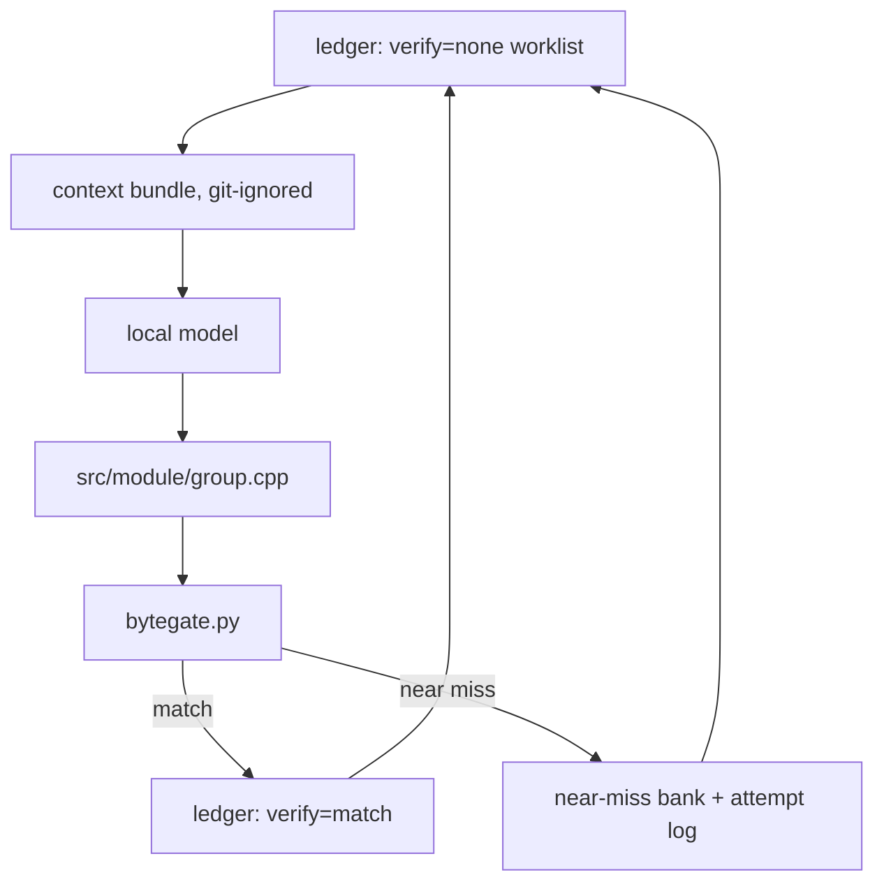

# LLM harness design (Phase 3 — the reconstruction loop)

The design for the tooling that **produces** reconstructed C++ from the original binary,
compiles it with the pinned toolchain, and banks the results. It is the counterpart to the
**byte gate**, which *verifies*. This document is design-first: the decisions below are agreed,
the code does not exist yet.

See also [`architecture.md`](architecture.md) → *Unmatched-function fallback* (why Model C),
*File layout & generated build* (where files come from), and [`tooling-survey.md`](tooling-survey.md)
→ the sm64ds pipeline (the mechanism this is modelled on).

---

## Where this sits

Two halves, and the split is load-bearing:

- **The gate — built.** `tools/ledger/bytegate.py` compiles one function and byte-diffs the
  function **body** against the original (the ledger's `size` is a block *partition*, an upper
  bound — see the gate's own docstring). It is the **only** writer of the ledger's `verify`
  axis, and it is independent of anything that produces a candidate.
- **The harness — this document.** Everything that *produces* candidates: it selects work,
  builds the model's context, calls the model, writes source, and invokes the gate. It never
  claims a match itself.

The rule, borrowed verbatim from sm64ds `tools/bank.py`: **never trust the solver's own claim
of a match — verify independently.** The harness proposes; the gate disposes.



---

## Worklist — the ledger is the queue

There is no separate worklist file: the **committed ledger** is the worklist, filtered to
entries with `verify=none` (later: `behaviour` entries eligible for a byte-match retry).
`data` and `external` kinds are skipped for the reconstruction loop. Because selection is
derived from the ledger, the queue updates itself as `verify` changes — no second artifact to
drift.

**Ordering is a difficulty prior, not link order.** The ledger's own order is `(module, addr)`
(link order), which puts a runtime initializer (`_init`) first — a poor place to start. The
driver therefore defaults to an **easy-first** order supplied by `tools/ledger/complexity.py`
(a library, callable by the loop *and* by future manual-decomp tooling). A function's **tier** —
`clean` (no call, no outbound branch, no image-referencing pool word) < `adr` (builds a
PC-relative address — a jump-table suspect) < `reloc` (calls/tail-calls, or a pool word that
resolves to an image reference) < `unreadable` — places the cleanest, self-contained leaves first,
with body size as the tiebreak. These byte-decidable signals approximate the gate's
"relocation-free leaf" — the only targets it can verify cleanly today (see `bytegate.py` →
*Scope*). Two details matter here: this image's `.text` carries no relocations of its own (they
all land in `.data`/`.got`), and its `ldr rd, [pc, …]` pool words are *always* PC-relative GOT
offsets (`ldr rd, [pc, rX]`), never constants — so with the loaded-block map
(`inventory.blocks.tsv`) a pool load resolves to an image reference and is tier `reloc`, while
without the map it falls back to a conservative pool-*use* tier. The signals' failure mode is to
*demote* a clean function — a harmless mis-order, since the gate, not the ranking, decides
matches. The score is derived (from the reference `.text`, the inventory body sizes, and the
block map — all git-ignored); the committed ledger is never mutated. Any injected ordering keeps
the `(module, addr)` tiebreak, so it stays deterministic and a resume is unaffected. `--order
addr` restores link order. The same library backs the selector CLI (`worklist.py --order
easiest`), so a human can list the easiest pending targets from the shell — the manual-decomp
tooling will call `complexity` directly.

---

## The declaration layer (Model C stubs)

Model C means an unmatched callee must at least be **declared** so the tree compiles. The
ledger supplies *identity* and, for externals, the exact Itanium-mangled name — and mangling
**encodes the parameter types**, so signatures are recoverable almost for free (`c++filt` /
`llvm-cxxfilt` are both installed; there are **761** external rows, e.g.
`_ZN2nn2fs11GetFileSizeEPxNS0_10FileHandleE` → `nn::fs::GetFileSize(long long*, nn::fs::FileHandle)`).

**Decided — phased, `asm` first, committed `include/` tree later.**

- **Phase A (now): pin the symbol, approximate the type.** Declare a call with an
  ABI-compatible prototype but force the exact mangled symbol with `asm`:

  ```cpp
  namespace nn::fs {
  int CreateFile(char const*, unsigned long long) asm("_ZN2nn2fs10CreateFileEPKcx");
  }
  ```

  This decouples **link identity** from **type completeness**: relocations resolve to the
  exact original symbol even while the C++ type set is still being reconstructed. It does *not*
  remove the ABI obligation — a by-value aggregate parameter (`nn::fs::FileHandle`,
  `nn::account::Uid`) still needs a correct layout to compile at all.
- **Phase B (grow): a committed `include/` tree reconstructed incrementally.** Types are
  added only as functions need them, and `asm` labels are retired as real declarations land.
  There is no wholesale generator, because **the hard part is type *definitions*, not
  signatures**: the ledger deliberately does not carry structs/classes (the nested-symbol table
  is *reference material*, never the ledger), so the type set is hand-grown — the
  `lib/nnheaders` problem in reverse.

  Seed the review with a **demangle pass** over the ledger's externals that emits *candidate*
  prototypes; signatures are exact, types are not.
- **Internal placeholders (`func_<addr>`)** have no mangling (C ABI). Declare them loosely
  (signature inferred from call sites or guessed); for byte-matching this is usually harmless
  — the first args go in `r0–r3`, the return in `r0` — and only matters for struct-by-value /
  64-bit / FP edge cases.

**Decided — link-time resolution of unmatched *internal* symbols.** "Declared but not
  defined" keeps the tree *compiling*; a developer executable still has to *link*. The options
  are staged, exactly like Model C → Model B in [`architecture.md`](architecture.md) →
  *Unmatched-function fallback*:

  - **The scaffold links nothing (compile-only).** The gate compiles one TU to an object and
    diffs the function's section; no linker is invoked. This is already how `bytegate.py`
    works, needs no stubs, and carries no ABI risk. The generated build stays *link-optional*:
    it can grow a linker script (with `-ffunction-sections -fdata-sections`, placement is
    per-section) without rework.
  - **Model C (a runnable developer executable) = weak stubs.** The generator emits each
    unmatched internal symbol as an empty, ABI-safe `__attribute__((weak))` definition; a
    matched function is a strong definition the linker prefers. Empty stubs are ABI-safe (the
    callee ignores `r0–r3`; the *caller's* bytes — all the match sees — are unaffected), and
    weakness removes the churn a strong-stub set would cause as functions flip to matched.
  - **Model B (the relocation/link check) = byte substitution.** Unmatched *regions* are
    filled from the original binary by the build (`rombytes`/`delinks`), so the linked image is
    byte-correct everywhere and the relocation check is meaningful. This is the one option
    that carries real AArch32 work — the NSO is a PIE with `.rel.dyn`/`.rel.plt` — and it is a
    scoped task of its own, not a scaffold rider.

  **Externals are a separate axis.** The `nn::` imports resolve via the loader/dynsym; a
  static link needs import stubs or the NSO import table. That is *external* resolution and
  does not bear on this decision.

---

## The context bundle

The bundle is the model's entire view of a function. It is **disassembly-first and annotated**,
and it is **generated into the git-ignored `baserom/work/` tree and never committed** (binary
content stays out of git — [`AGENTS.md`](../AGENTS.md) → *Repository hygiene*).

Per `(module, addr)` the bundle carries:

- **Annotated disassembly of the original.** Raw linear disasm is not enough: resolve each
  `bl`/`blx` to its callee, each pc-relative load to its literal-pool value/symbol, and mark
  branch targets. (Extend `tools/ghidra/DisasmFunctions.java`.)
- **Reference bytes** (hex) for the body, plus the ledger metadata (`name`, `addr`, `block`,
  `group`, partition `size`).
- **Callee signatures** for the functions it calls (from the declaration layer above).
- **Later:** N few-shot already-matched siblings sharing the mnemonic sequence.

Two properties are non-negotiable:

- **Deterministic and one-way.** The generator only reads (binary + ledger) and writes under
  `baserom/work/`. It never edits the ledger or `src/`.
- **Body extent, not partition.** The disassembly and the reference bytes must stop at the
  function's true end, or the bundle drags in the next routine. This is the *same*
  partition-vs-body gap the gate was fixed for; `--body` / a disassembly-derived extent is the
  shared mechanism.

**Built — `tools/loop/bundle.py`.** The extent is resolved from the full-analysis inventory
(`baserom/work/inventory/inventory.tsv`, whose function `size` is the real body and matches the
`poc/` probes exactly: `func_601a72e4` is 60 B, not its 1368 B partition) or an explicit
`--body`; the ledger partition is never used. One Ghidra headless run dumps the memory blocks
and the body range together (`tools/ghidra/AnnotateFunctions.java`, a sibling of the frozen
`DisasmFunctions.java` — the PoC's copy is left untouched); it emits addresses, not names, so
name resolution stays in Python where the committed ledger is the naming authority. Branch and
`bl`/`blx` targets become `-> loc_<addr>` / `-> <ledger name>`; a pc-relative load's operand is
resolved to its absolute slot and the loaded word is shown (`= 0x…`). Output is a deterministic
markdown bundle under the git-ignored `baserom/work/context/` (verified byte-identical across
runs).

**Decided — the Ghidra decompiler draft is excluded from the LLM context.** The decompiler
emits semantically-correct, readability-optimised C, but byte-matching is *instruction idiom
and scheduling*, not semantics (the whole of [`compiler-identification.md`](compiler-identification.md)
is evidence that equivalent C compiles to different bytes). A draft anchors the model on the
decompiler's structure and away from the original compiler's idioms — a clean compile and a
mismatch. The draft is **kept as an option for human decompilers**, but for the model it simply
does not exist: the bundle schema has no draft field, so the harness cannot be tempted to pass
one.

---

## The harness

A **custom, repo-local, dependency-light Python harness** — deliberately *not* a framework
(LangChain and friends). We need deterministic worklist ordering, an independent verification
step, and the eval pin, none of which a framework exposes cleanly. This is the sm64ds toolkit
rebuilt in-repo:

| sm64ds tool | role | harness analogue |
| --- | --- | --- |
| `tools/worklist.py` | pre-resolved per-function worklist | ledger worklist + context bundle |
| `tools/bank.py` | independent verify-and-bank | `tools/ledger/bytegate.py` |
| `tools/nearmiss_db.py` | near-miss bank, strictly-improving upsert, eval pin | near-miss bank |
| `tools/match_attempts.py` | append-only, parent-linked attempt log | attempt log |
| `tools/classqueue.py` | claims over git refs | deferred until multi-contributor |

The loop, per entry:

1. **Select** the next `verify=none` entry from the ledger.
2. **Propose** a candidate: a deterministic **template** (`tools/ledger/templates.py`) if the
   function's bytes match a known shape, else the **context bundle** + local model.
3. **Write** the candidate to `src/<module>/<group>.cpp`.
4. **Verify** with `bytegate.py` (independent).
5. On **match:** `set_field(verify=match)` (line-surgical; leaves `enroll`/`review` alone).
   On **near miss:** record it, don't discard it.

**Templates before the model — propose; the gate disposes.** Some functions have exactly one
plausible C spelling (an empty body is `void f() {}`; a constant return is `int f() { return K; }`),
so an LLM adds only latency and variance. `tools/ledger/templates.py` is a small rulebook — a
library, pure `bytes -> source`, callable by the loop *and* manual tooling — that recognizes such
shapes and emits the canonical source, clearing the trivial leaf band instantly and for free (the
sm64ds *automatic templates* precedent, scoped to exact instruction patterns). It **never claims a
match**: the gate still compiles and compares, so a wrong template is a near miss, never a false
match; on a template miss the loop falls through to the model, so the path cannot regress. Template
detection needs neither the bundle nor the model, so a structural leaf skips both (one Ghidra
import and one model call saved). Each attempt records its `source` (`template` vs `model`) and,
for a template hit, the `template_rule` (`{n, name}` — the 1-based rule the driver prints as
`(template rule #N: name)`).

**Template growth is measured, not guessed.** Which rule to add next is a *data* question, so
`tools/ledger/shapes.py` decodes a body's words to a normalized **shape signature** (registers and
condition kept, immediates collapsed to `#`) and `tools/ledger/shape_report.py` histograms the
pending corpus, most-frequent un-templated shapes first. Both live under `tools/ledger/` (libraries
shared with manual tooling; the report only reads). The decoder is **assembler-checked**: its golden
vectors were emitted by the pinned clang, and a corpus spot-check against Ghidra found and fixed a
condition-table bug (`ls` decoded as `vc`) — exactly why the check exists. The first pass (42,997
pending functions; 4,320 tier-0 leaves; 670 already template-covered) shows the un-templated
tier-0 opportunity concentrated in a few families — parameterized pointer/index arithmetic
(`add r0,r0,#; bx lr`; `mov r1,#; str r1,[r0,#]; bx lr`), single-field byte/word/halfword
accessors, and a large **bounds-checked array accessor** family (`mov r2,r0; mov r0,#0;
ldr r3,[r2,#n]; cmp r3,r1; bxls lr; …`). Acting on the top of that list, the parameterized
families were added as rules (`add-const`, `store-const-word`/`-byte`, `half-getter`,
`sbyte-getter`, `far-word-getter`/`-byte`) and gate-verified: the batch went from 670 to **816**
tier-0 byte-exact matches, 816/816 verified, 0 failures.

By contrast the sm64ds **struct-copy** idiom the bundle prompt's worked example teaches is ~1% of
functions, so that example was disproportionate. It is now **conditional**
(`run.has_nonstack_block_move`): the copy section appears only when the bundle carries an
`ldm`/`stm` on a non-`sp` base — a `push`/`pop` save does not trigger it — while the general
layout/padding guidance stays unconditional.

**Built — `tools/loop/run.py` (the driver).** It wires the above together and is the one place
that could overstep, so **containment is by construction**: the model only ever returns text,
and every path the driver writes is derived **solely from the ledger** (`src/<module>/<group>.cpp`
and `baserom/work/attempts/…`) behind a resolve-and-require-under-root guard — ledger components
to a separator or `..` are refused outright. Model text is written to a file and never enters
argv, a shell, `eval`, or a compiler flag; compilation is a fixed-argv, in-container subprocess.
The gate is invoked with `--update` (it is the **only** writer of `verify`, and only on a real
match).

**Near misses are evidence, not waste** (`AGENTS.md`). Two append-only records, both
git-ignored under `baserom/work/` — **built** as `tools/loop/attempts.py` and
`tools/loop/nearmiss.py`:

- **Attempt log** (`attempts.py`) — every attempt, parent-linked so retries form a tree, in
  `baserom/work/attempts/log.jsonl`, with each candidate kept at
  `baserom/work/attempts/<module>/<addr>/<id>.cpp`.
- **Near-miss bank** (`nearmiss.py`) — strictly-improving upsert with
  `closeness = (divergences, |cand_size − size|)`, in `baserom/work/nearmiss/bank.json`. The
  closeness pairs come straight from the gate's structured `--report`, never re-derived, so the
  gate stays the sole authority on a comparison. (`floor` marks for compiler-internal residuals
  remain to be added.)

**The eval pin** fingerprints the compiler pin (`config/toolchain.json`) and the closeness
metric. If either changes, the bank **warns** rather than silently comparing incomparable
numbers (a record written under a different pin is treated as absent). This is also the
mechanism that makes any future experiment (e.g. "does a decompiler draft help?")
trustworthy: A/B it against a pinned eval, not by vibes.

**Decided — where the losing candidate lives.** Matched source is the project's own output and
lives in `src/`; drafts and attempts are binary-adjacent evidence and live, git-ignored, under
`baserom/work/attempts/`. The driver writes the candidate to its ledger-derived `src/` path only
long enough for the gate to compile it, and moves it into the attempt store on anything but a
match — so `src/` holds **matched code only**, and a merged translation unit (several entries
sharing a `group`) is never disturbed. A committed, textual near-miss summary remains open (the
sm64ds shape).

**Built — the model client (HTTP).** `tools/loop/model.py` is the OpenAI-compatible
`/v1/chat/completions` client (standard-library `urllib`, no framework), configured by
`config/model.json` (no secret stored — the API key is read from the environment variable the
config names). A CLI-invocation variant remains **open**: the client is behind a ``Model``
protocol so a second backend is additive, not a rewrite.

**Built — retry feedback (a retry revises, it does not resample).** A mismatch used to be
resampled with a byte-identical prompt: measured on the first corpus run, 11 stuck functions drew
106 attempts between them, every retry with the same `prompt_sha256`. Now the gate reports the
precise divergence — the differing A32 words as `diff_words` (`{offset, got, want}`) — and on a
compile failure the compiler output; `run.py` reads the previous attempt's record back and appends
a *Previous attempt did not match* section naming the exact instructions (with the reference
mnemonic taken from the bundle) next to the previous translation unit, so the model **edits** the
divergence rather than regenerating. A retry also stops early once a mismatch repeats the *same*
`diff_words` (the feedback moved nothing, so further tries are waste). A candidate that never
compiles draws on a **separate, smaller budget** (`--compile-attempts`, default 2): once that
many attempts were rejected by clang the entry is abandoned, so a model that keeps emitting
non-compiling code (e.g. a wrong signature or a missing declaration) stops on its own
threshold instead of burning every match attempt. `--no-feedback` restores
plain resampling for A/B, and the first attempt is untouched, so a single-attempt run and the
pre-feedback prompt stay byte-identical.

**Built — a truncated reply stops the entry.** An empty reply used to be a silent `error`: the
attempt was not recorded, nothing said *why*, and the retry re-sent the same prompt. Observed
against a remote reasoning model, every such reply was exactly `max_tokens` (12000) of
completion with `content: ""` and `finish_reason: "length"` — the reasoning trace consumed the
whole budget before the answer began, so each retry re-paid ~12k tokens for nothing. The
message now reports `finish_reason`, the completion tokens, and the reasoning length, and a
`length` truncation returns `truncated`, which `attempt_entry` treats as terminal (`error`,
no retry) and explains with the `--max-tokens` / reasoning-off hint. The cap is also
overridable per run (`--max-tokens`), because `config/model.json`'s value is sized for the
local model and would otherwise be inherited verbatim by any `--base-url` override.

**Built — reasoning can be turned off.** DeepSeek-style endpoints enable a thinking trace by
default and bill it inside `max_tokens`, so the trace can consume the entire budget before the
answer begins. The client therefore sends `reasoning_effort` only when configured
(`config/model.json` or `--reasoning-effort`; `"none"` disables thinking), and captures
`usage.completion_tokens_details.reasoning_tokens` into the completion and the attempt record so
the reasoning share of a reply is visible rather than inferred.

**Built — a cross-run attempt budget.** `--attempts` is per invocation, so an entry that never
matches stays pending and returns to the front of the queue on every run; measured on the first
corpus, 348 attempts sat at attempt position 5+ for 2.3M completion tokens, and 291 entries had
never matched at all. `--skip-attempted N` drops entries that already drew `N` attempts in the
log (`1` = only fresh entries, the recommended setting for a paid remote model), and the
selection reports when it ran out of eligible entries so the flag is not mistaken for an empty
ledger. This is a *selection* budget, not a verdict: the entry stays pending, and `--entry
`<addr>` bypasses the filter, so a deliberate revisit is still one command away.

**Built — near-miss revisit selection (`--from-bank`).** The bank's closest-first order is only
useful if it can drive a run, and `--entry` takes one address at a time. `--from-bank` therefore
restricts the queue to entries that have a **current-pin** near miss and orders it by `closeness`
(closest first), *overriding* `--order`; `--bank-max-len-delta` (default `0` — same-length, the
reviewable ones) and `--bank-max-divergences` bound how close a record must be. Records written
under a different eval pin are dropped, because their numbers are not comparable.

**Built — a tier cap (`--max-tier`), because most of the queue cannot match yet.** The gate
compares **raw object bytes**, so a function whose object carries a relocation (it calls out,
tail-branches out, or loads a reference from the pool — ``complexity`` tier 2) can never match
until the relocation-aware diff exists: every one of the 2,316 matches sits at tier 0, and none
of the 37,978 pending tier-2 entries has ever matched. `--max-tier N` drops entries above tier
`N`, so a run spends tokens only on functions the gate can actually verify (`0` = clean leaves,
the defensible setting today; `1` also admits jump-table suspects). Without it, `--order
easiest` feeds the model the whole unmatchable tail once tier 0 is exhausted, which is exactly
the observed collapse: the fresh queue's median body grew 32 B → 76 B (mean 140 B) and a day of
2,766 attempts produced 8 matches (~1.06M tokens per match). The cap is a *selection* filter,
not a verdict — nothing is written to the ledger.

**Known bank contamination.** A tail branch in an unlinked object is encoded as the
``b .`` placeholder (`0xEAFFFFFE`, `R_ARM_JUMP24` unapplied), so a correct source that tail-calls
mismatches on that one word. Such entries (64 banked at len_delta 0, ≤3 divergences, all tier 2)
are **not** near misses in the source sense and must not be "fixed" by retrying — they are
blocked on the relocation-aware diff. `--max-tier 0` excludes them automatically.

**Built — verified idiom spellings in the prompt.** The stuck front of the queue was not failing
for want of reasoning: candidates called builtins that do not exist (`__builtin_arm_bfc`,
`__builtin_arm_ubfx`, `__builtin_arm_sbfx`), used a two-argument `__builtin_arm_rbit`, or wrote
padding that computed to a negative size. Each spelling in the prompt section was therefore
**probed against the pinned clang 5.0.1** before being written down: `rbit` is
`__builtin_arm_rbit(x)` (one argument), `ubfx`/`sbfx` are shift-and-mask forms, `bfi` is a
mask-merge or a bitfield store, `bfc` only comes from a bitfield store of 0 (a clear whose mask
fits a `bic` immediate lowers to `bic` instead), `rev16` needs a 16-bit value, and `revsh` is
`(short)__builtin_bswap16(x)`. The section is **conditional** (`has_bit_op`), like the struct-copy
guidance, so functions that contain none of these instructions do not pay for it.

---

## Decisions and open questions

| # | question | status |
| --- | --- | --- |
| 1 | Declaration strategy | **Decided** — `asm("mangled")` now, committed `include/` tree grown over types later |
| 2 | Signature source for externals | **Decided** — demangle the ledger's 761 externals (exact function types); implemented by `tools/build/seed_externals.py` → `include/generated/` |
| 3 | Ghidra decompiler draft in LLM context | **Decided** — excluded; retained for humans |
| 4 | Bundle order | **Decided** — disassembly-first, annotated; deterministic, one-way, git-ignored |
| 5 | Harness shape | **Decided** — custom repo-local Python; not a framework |
| 6 | Match authority | **Decided** — the gate is the only writer of `verify` (independent verify) |
| 7 | Attempt/near-miss storage | **Built** — parent-linked log (`attempts.py`) + strictly-improving bank with the eval pin (`nearmiss.py`); `floor` marks remain |
| 8 | Link-time resolution of unmatched internal symbols | **Decided** — scaffold compile-only; Model C weak stubs; Model B byte substitution |
| 9 | Model endpoint shape (HTTP vs. CLI) | **Partially decided** — OpenAI-compatible HTTP client built (`tools/loop/model.py`); CLI variant open |
| 10 | Disassembly-derived function extent | **Resolved for the bundle** — the full-analysis inventory's function `size` (validated against the `poc/` probes); `--body` overrides; the ledger partition is never used. Entries absent from the inventory still require `--body` (shared with the gate, which keeps its own `--body` stopgap) |
| 11 | Auto-selection order (no `--entry`) | **Built** — easy-first difficulty key (`tools/ledger/complexity.py`, a library shared with manual tooling), default on the auto-select path; `--order addr` restores the ledger's link order |
| 12 | Trivial-leaf handling | **Built** — deterministic templates (`tools/ledger/templates.py`) tried before the model; propose-not-decide (the gate still verifies), model fallback on a miss; coverage grows by adding rules |
| 13 | Which shape to template next | **Built** — measured, not guessed: `tools/ledger/shapes.py` (assembler-checked A32 shape decoder) + `tools/ledger/shape_report.py` (pending-corpus histogram); rules are chosen from the most-frequent un-templated shapes and gate-verified before banking. First expansion: the parameterized add/store-const/half/sbyte/far getter families (670 → 816 tier-0 matches) |
| 14 | Bundle prompt struct-copy section | **Built** — conditional on a non-stack `ldm`/`stm` in the bundle (`run.has_nonstack_block_move`); the ~1% idiom no longer dominates the prompt, and the general layout guidance stays unconditional |
| 15 | Retry feedback on a mismatch | **Built** — the gate's `diff_words` + the previous candidate are fed into the next attempt's prompt (`run.feedback_section`), with a stall stop when the divergence repeats and a separate `--compile-attempts` budget for candidates that never compile; `--no-feedback` restores resampling |

---

## Layout

```text
tools/loop/
  worklist.py     # ledger query -> ordered verify=none entries   [built; key-injectable]
  bundle.py       # per-entry context bundle -> baserom/work/context/  [built]
  model.py        # endpoint client (HTTP)          [built]
  run.py          # the driver: select -> bundle -> model -> write -> gate -> bank  [built]
  nearmiss.py     # near-miss bank + eval pin         [built]
  attempts.py     # append-only, parent-linked attempt log  [built]
tools/ledger/
  complexity.py   # easy-first difficulty key (library; loop + manual tooling)  [built]
  templates.py    # deterministic trivial-leaf templates (library; loop + manual tooling)  [built]
  shapes.py       # A32 shape decoder + signature/histogram (library; loop + manual tooling)  [built]
  shape_report.py # pending-corpus shape histogram report (analysis CLI)  [built]
tests/ledger/     # unit tests mirroring tools/ledger/  [complexity, templates, shapes, shape_report, bytegate, validate covered]
tests/loop/       # unit tests mirroring tools/loop/    [model, worklist, bundle, run, attempts, nearmiss covered]
include/          # committed declarations + types     [seed built: include/generated/]
src/<module>/<group>.cpp   # candidates (committed); one function per file by default
```

`tests/` follows the existing `tests/<tool>/` convention (see `tests/ledger/`). Every file is
a plain stdlib `unittest` script, runnable on its own; run them all with
`python3 tools/run_tests.py`.
